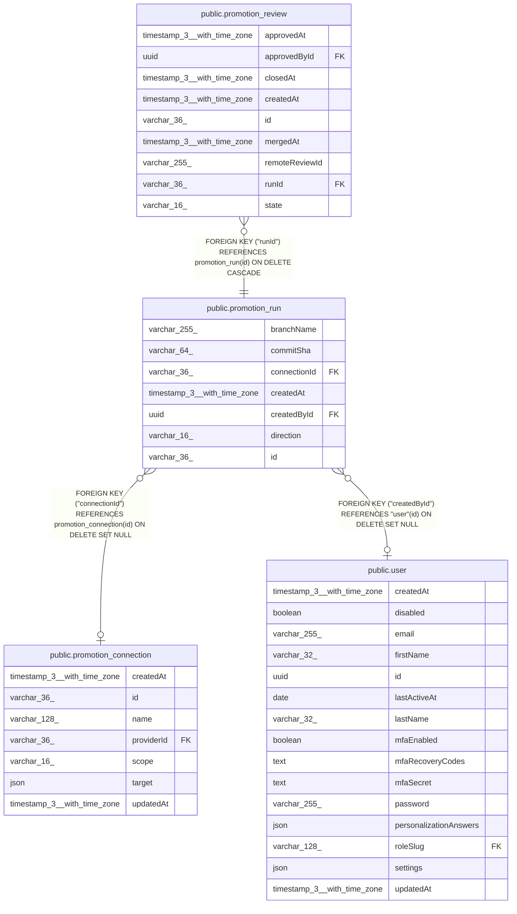

# public.promotion_run

## Columns

| Name | Type | Default | Nullable | Children | Parents | Comment |
| ---- | ---- | ------- | -------- | -------- | ------- | ------- |
| branchName | varchar(255) |  | false |  |  | The branch this run pushed or applied. |
| commitSha | varchar(64) |  | false |  |  | The commit this run pushed or applied. |
| connectionId | varchar(36) |  | true |  | [public.promotion_connection](public.promotion_connection.md) | The connection this run used. NULL after the connection is deleted. |
| createdAt | timestamp(3) with time zone | CURRENT_TIMESTAMP(3) | false |  |  |  |
| createdById | uuid |  | true |  | [public.user](public.user.md) | The user who ran Promote or Apply. |
| direction | varchar(16) |  | false |  |  | PromotionDirection enum: "promote" pushes to the remote, "apply" imports from it. |
| id | varchar(36) |  | false | [public.promotion_review](public.promotion_review.md) |  |  |

## Constraints

| Name | Type | Definition |
| ---- | ---- | ---------- |
| CHK_promotion_run_direction | CHECK | CHECK (((direction)::text = ANY ((ARRAY['promote'::character varying, 'apply'::character varying])::text[]))) |
| FK_promotion_run_connectionId | FOREIGN KEY | FOREIGN KEY ("connectionId") REFERENCES promotion_connection(id) ON DELETE SET NULL |
| FK_promotion_run_createdById | FOREIGN KEY | FOREIGN KEY ("createdById") REFERENCES "user"(id) ON DELETE SET NULL |
| PK_f5b941d810bf2eb7a5f8327f446 | PRIMARY KEY | PRIMARY KEY (id) |
| promotion_run_branchName_not_null | n | NOT NULL "branchName" |
| promotion_run_commitSha_not_null | n | NOT NULL "commitSha" |
| promotion_run_createdAt_not_null | n | NOT NULL "createdAt" |
| promotion_run_direction_not_null | n | NOT NULL direction |
| promotion_run_id_not_null | n | NOT NULL id |

## Indexes

| Name | Definition |
| ---- | ---------- |
| IDX_721876320c769ad6ce58268b14 | CREATE INDEX "IDX_721876320c769ad6ce58268b14" ON public.promotion_run USING btree ("connectionId") |
| PK_f5b941d810bf2eb7a5f8327f446 | CREATE UNIQUE INDEX "PK_f5b941d810bf2eb7a5f8327f446" ON public.promotion_run USING btree (id) |

## Relations

---

> Generated by [tbls](https://github.com/k1LoW/tbls)
